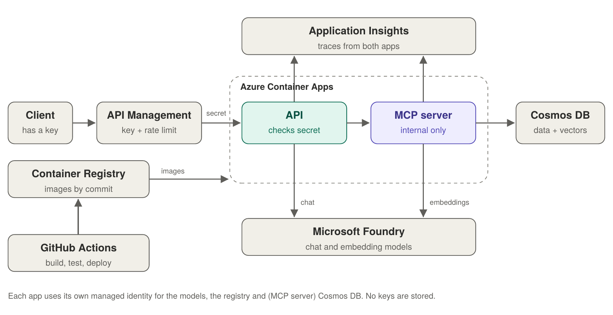
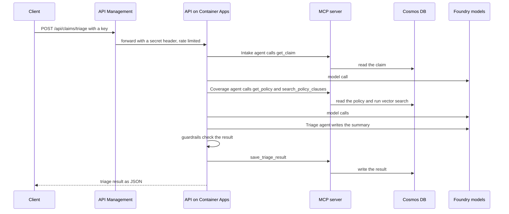
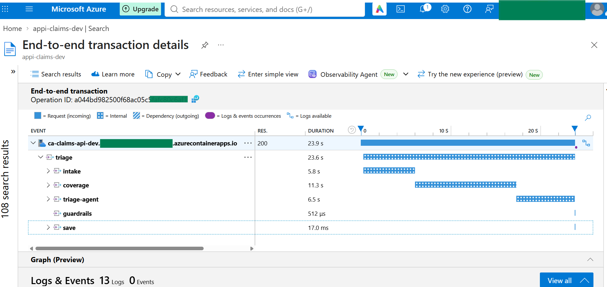
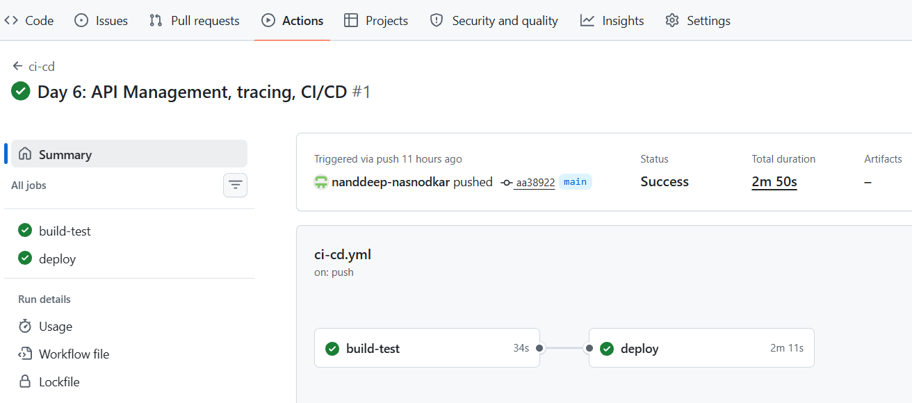
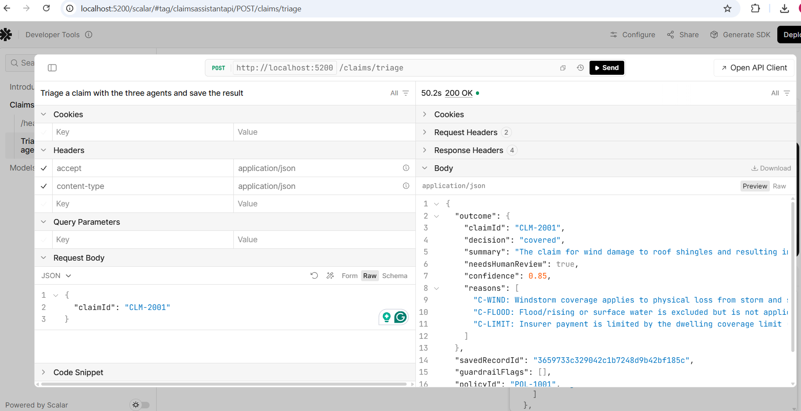

# Claims Assistant


A multi-agent assistant that triages homeowners insurance claims. Three AI agents read a claim,
check it against the policy, and propose an outcome. Plain code then applies safety rules and
saves the result. Built in C# on Azure in one week as a portfolio project.

> All data is synthetic. This is a demonstration, not insurance advice.

[Watch the 2-minute demo](https://youtu.be/SFPpQqM_i20)

## What it does

1. A client sends a claim ID to `POST /claims/triage` through an API gateway.
2. The **Intake** agent reads the claim and extracts the facts.
3. The **Coverage** agent looks up the policy and searches its clauses by meaning (vector
   search) to decide if the loss is covered. It cites the clauses it relied on.
4. The **Triage** agent writes a short summary for a human adjuster.
5. **Guardrails** (plain code, not AI) check the result and force human review for risky cases.
6. The application saves the final result and returns it.

## Architecture





## Key design decisions

| Decision | Why | Trade-off |
|---|---|---|
| Tools exposed through an **MCP server** | One clear, reusable contract between agents and data | One more service to run |
| Agents have **read-only tools**; the application writes | No AI agent can change data. Writes happen after the checks | Slightly more code |
| **Guardrails in code** | Business rules should be deterministic and testable, not left to a prompt | Rules need maintaining |
| Typed results (`RunAsync<T>`) between agents | Each step passes an object, not free text | Needs a model with structured output |
| **Managed identities**, one per app | No keys in config. Each app gets only the access it needs | Role assignments to set up |
| **Cosmos DB serverless** with vector search | Pay per use; clause search needs no separate vector store | Fewer tuning options than a dedicated service |
| API Management **Consumption** + shared secret | Key and rate limit in front of the API at pay-per-call cost | A shared secret is weaker than token validation |
| **Sequential orchestration** in plain C# | Easy to read, test and trace | No built-in retries or branching |
| GitHub Actions with **OIDC** | Deploys without any stored cloud password | Needs a federated credential |
| Images tagged with the **commit ID** | Every deployment is traceable and can be rolled back | The pipeline owns the tags |

## Guardrails

The agents propose an outcome. Before anything is saved, these rules run in code. They can only
make the outcome safer: they add review flags and never remove one.

| Condition | Effect |
|---|---|
| Decision is not one of the four allowed values | Becomes `needs_review` |
| Triage and Coverage decisions disagree | Becomes `needs_review` |
| Confidence is outside 0 to 1, or below 0.7 | Human review |
| Decision is `not_covered` | Human review (denials always get a person) |
| Estimated amount is 100,000 or more | Human review |
| Amount exceeds the coverage limit | Human review |
| No policy clause is cited | Becomes `needs_review` |
| A claim ID returned by an agent does not match the request | Flagged, and the requested ID is used |

13 unit tests cover these rules (`dotnet test`).

## Security model

- **No stored secrets in the repo or in GitHub.** Apps use managed identities. GitHub signs in to
  Azure with OpenID Connect.
- **API Management** requires a subscription key and limits each key to 10 calls a minute. It adds
  a shared secret header and removes the key before calling the API. The API rejects calls
  without that header.
- The **MCP server has internal ingress only** and is not reachable from the internet.
- **Strict input validation:** the claim ID must match `CLM-` followed by 3 to 10 digits, because
  it is placed in a model prompt.
- Prompts and model answers are **not** recorded in traces.

## Observability

OpenTelemetry sends traces to Application Insights. One request shows its steps (intake, coverage,
triage, guardrails, save), the model calls, the calls to the MCP server and each tool call, in a
single timeline.



## CI/CD

`.github/workflows/ci-cd.yml` builds and tests every push and pull request. Pushes to `main` build
the two container images, tag them with the commit ID, update the two Container Apps and check
that the API is healthy.



## API

```
POST /claims/triage
Content-Type: application/json

{ "claimId": "CLM-2002" }
```

An illustrative response (the wording varies between runs):

```json
{
  "outcome": {
    "claimId": "CLM-2002",
    "decision": "not_covered",
    "summary": "Flood damage is excluded under this policy.",
    "needsHumanReview": true,
    "confidence": 0.9,
    "reasons": ["Flood and surface water loss is excluded (C-FLOOD)",
                "Guardrail: Denials always need human review"]
  },
  "savedRecordId": "3f2a...",
  "guardrailFlags": ["Denials always need human review"],
  "policyId": "POL-1001",
  "estimatedAmount": 12000
}
```

Errors use standard problem-details JSON: 400 for bad input, 401 without a valid key, 404 for an
unknown claim, 429 when rate limited, 502 and 504 for upstream failures.



## Run it locally

You need the .NET 10 SDK, the Azure CLI (`az login`), and an Azure subscription with a Microsoft
Foundry resource that has a chat model and `text-embedding-3-small` deployed.

1. Deploy the infrastructure (Cosmos DB and the rest) with the Bicep in `infra/`. See below.
2. Put your settings in user secrets, for example for the MCP server:
   ```
   dotnet user-secrets init --project src/ClaimsAssistant.McpServer
   dotnet user-secrets set "Cosmos:Endpoint" "https://YOUR-ACCOUNT.documents.azure.com:443/" --project src/ClaimsAssistant.McpServer
   dotnet user-secrets set "OpenAI:Endpoint" "https://YOUR-RESOURCE.openai.azure.com/" --project src/ClaimsAssistant.McpServer
   ```
   and the chat settings (`OpenAI:Endpoint`, `OpenAI:ChatDeployment`) for the API project.
3. Load the synthetic data: `dotnet run --project src/ClaimsAssistant.McpServer -- seed`
4. Start the MCP server: `dotnet run --project src/ClaimsAssistant.McpServer --urls http://localhost:5100`
5. Start the API: `dotnet run --project src/ClaimsAssistant.Api --urls http://localhost:5200`
6. Open `http://localhost:5200/scalar` and try `POST /claims/triage` with `CLM-2001`.

Run the tests with `dotnet test`.

## Deploy to Azure

The `infra/` folder holds Bicep for everything: Cosmos DB, container registry, Container Apps,
managed identities and their roles, Application Insights, the GitHub deployment identity, and
(in `apim.bicep`) API Management. Deployment runs in two phases because the apps need images
that exist: phase 1 creates the infrastructure, you push the images, and phase 2 creates the
apps. Copy `infra/main.bicepparam`, fill in your own names, and pass personal values such as your
object ID and the shared secret on the command line.

## Cost and teardown

Main cost drivers: model tokens, Container Apps (one small replica stays running for the MCP
server), the container registry, Application Insights and Log Analytics, and API Management
calls beyond the free monthly amount. Cosmos DB is serverless and API Management uses the
Consumption tier, so idle cost is low, but check Azure Cost Management after a week.

To remove the project resources, run `scripts/teardown.ps1` (a dry run by default; add `-Delete`
to delete). It keeps the Foundry resource and its model deployments.

## What I would do differently

- Verify Entra ID tokens at the gateway instead of a shared secret.
- Add an evaluation suite (groundedness, citation checks, regression tests) that runs in CI.
- Make the MCP connection resilient: reconnect, retries and a circuit breaker instead of one
  connection at startup.
- Pass cancellation tokens through the agent calls, so timeouts really stop the work.
- Use private networking for Cosmos DB, the registry and the models, and Key Vault for secrets.
- Put the Foundry resource in its own resource group and narrow the pipeline's role.
- Verify that every cited clause ID was actually returned by the search tool.
- Add API-level integration tests with a fake MCP server.

## Repository layout

```
src/ClaimsAssistant.Agents      agents, prompts, guardrails, pipeline
src/ClaimsAssistant.Api         minimal API: validation, rate limit, secret check, tracing
src/ClaimsAssistant.McpServer   MCP server with four tools over Cosmos DB
src/ClaimsAssistant.Shared      shared models and interfaces
src/ClaimsAssistant.Harness     console runner for the pipeline
tests/ClaimsAssistant.Tests     guardrail unit tests
infra/                          Bicep (Container Apps, Cosmos DB, APIM, identities, monitoring)
data/                           synthetic policies, clauses and claims
docs/                           architecture diagram and notes
scripts/                        teardown script
.github/workflows/ci-cd.yml     build, test, deploy
```

## License

MIT. See `LICENSE`.
